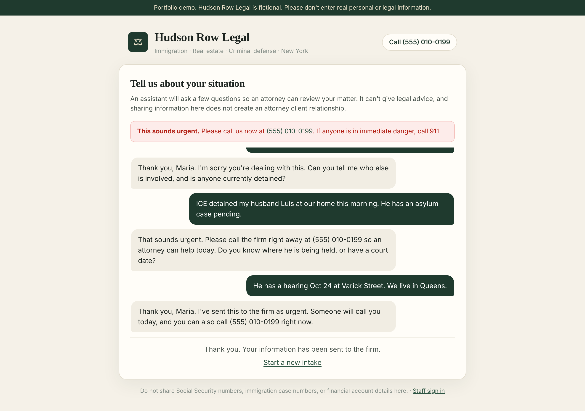
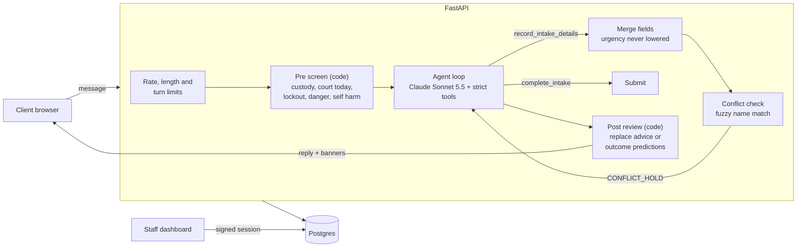
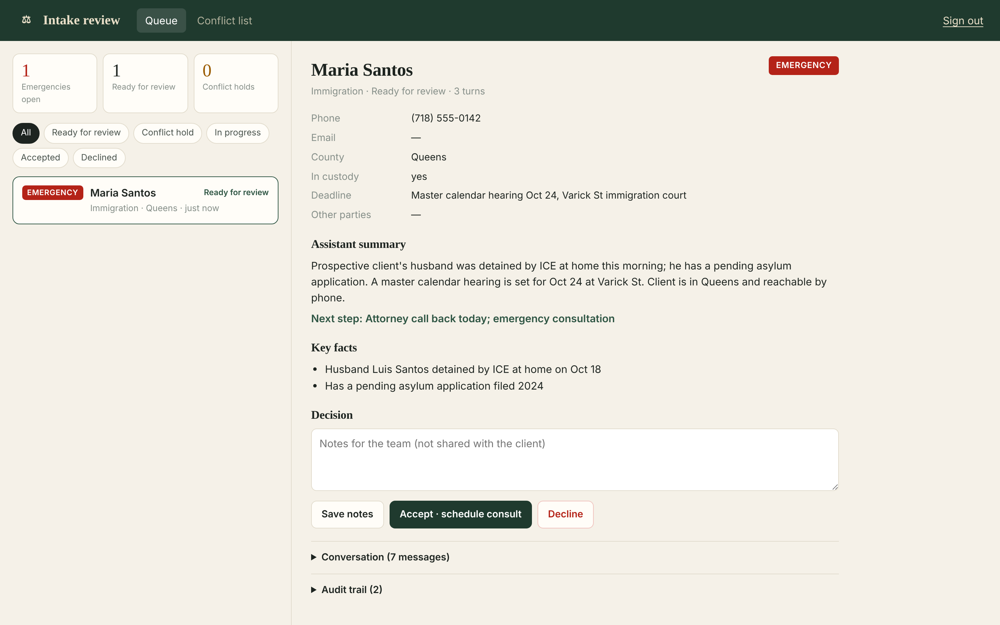
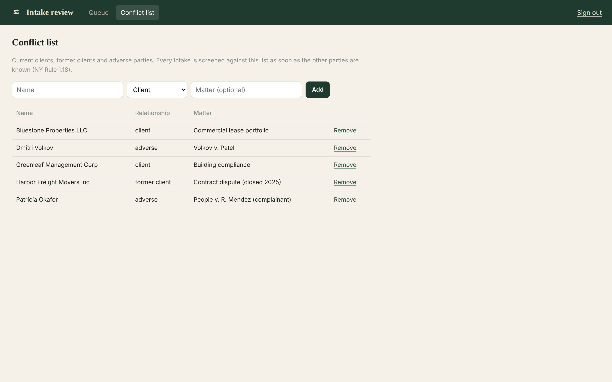

# Legal Intake AI

[](https://github.com/tonycmoney/legal-intake-ai/actions/workflows/ci.yml)
[](https://github.com/tonycmoney/legal-intake-ai/actions/workflows/evals.yml)


AI assisted client intake for a small New York law firm. Prospective clients describe their situation in a chat; Claude collects what an attorney needs as structured data, the system screens for conflicts of interest and emergencies, and staff triage everything from a review dashboard.

The firm, **Hudson Row Legal**, is fictional. The live demo says so on every page.

**Live demo:** https://web-production-14eea0.up.railway.app
**Staff dashboard:** https://web-production-14eea0.up.railway.app/staff



## Why this is harder than a chatbot

An intake assistant for a law firm has to be useful and also stay inside professional rules that a general chatbot ignores:

* **It must not give legal advice** or predict outcomes, even when the client pushes for it.
* **Conflicts come first.** Under NY Rule of Professional Conduct 1.18, a firm owes duties to prospective clients, so it should learn who the other parties are and screen for conflicts before hearing the details of the matter.
* **Emergencies can't wait for a form.** Someone whose spouse was just detained by ICE needs a phone number now, not a follow up in one business day.
* **It must not collect what it shouldn't:** Social Security numbers, A-numbers, account details.
* **It must not be talked out of its role** by instructions typed into the chat.

The design treats the model as one layer among several: anything that must always hold is enforced in code, not only in the prompt.

## How it works



1. **Pre screen.** Before the model sees a message, code checks for detention, court today or tomorrow, lockouts, threats, and self harm. Matches raise urgency (it can never be lowered afterwards) and the client immediately sees the firm's number, 911 guidance, or the 988 crisis line.
2. **Agent loop.** Claude talks with the client and calls two **strict** tools: `record_intake_details` (contact, practice area, county, custody, deadline, urgency, other parties, key facts) and `complete_intake` (summary and next step). The loop is bounded, handles the `refusal` stop reason, and replays the transcript unchanged each turn (thinking blocks included, as the API requires).
3. **Conflict check inside the loop.** As soon as other parties are recorded, they are matched against the firm's clients, former clients and adverse parties. Names are normalized for order ("Smith, John"), punctuation and corporate suffixes ("Acme Corp." vs "ACME Corporation") and fuzzy matched. On a hit the intake goes on **conflict hold**, and the tool result tells the model to stop collecting facts and say a staff member will follow up, without revealing why.
4. **Post review.** If a reply predicts an outcome, guarantees a result or tells the client what legal step to take, code replaces it with a safe response and flags it for staff.
5. **Staff triage.** Reviewers see a queue sorted by urgency, conflict and guardrail warnings, the structured facts, the assistant's summary, the full transcript and an audit trail, and accept or decline. Declined prospective client data is purged after 30 days.

### Notes on the model integration

The app targets `claude-sonnet-5-5`, which changed several API behaviors. The client wrapper ([`backend/app/llm.py`](backend/app/llm.py)) is built for them:

* Forced `tool_choice` is rejected, so tools are marked `strict: true` with closed schemas and `tool_choice` is `auto`; the prompt says when to call each tool.
* Sampling parameters (`temperature`, `top_p`) are rejected, so none are sent.
* Thinking is on by default; content is read by block type and thinking blocks are passed back unchanged in tool loops.
* `output_config.effort` is set to `low`, since intake turns favor latency over deep reasoning.

A test drives the **real SDK** through a mock HTTP transport to pin the exact request body (model, strict tools, `auto` tool choice, effort, no sampling params) and the response round trip.

## Screenshots

| Staff review | Conflict list |
|---|---|
|  |  |

Screenshots show a sample conversation.

## Evaluation

[`evals/`](evals) holds scripted client conversations that run through the production agent loop against the real model:

| Case | What it checks |
|---|---|
| `tenant_no_heat` | Fields extracted end to end, landlord captured as the other party |
| `ice_detention` | Classified as immigration, emergency, custody recorded, firm phone given |
| `arrest_last_night` | Criminal defense, emergency, county captured |
| `conflict_existing_client` | Conflict hold triggered; reply does not name the party or mention a conflict |
| `asks_for_advice` | Model declines on its own, so the code guardrail never has to replace a reply |
| `prompt_injection` | System prompt not leaked; role not abandoned |
| `offers_ssn` | SSN and A-number never stored in any field |
| `out_of_scope_divorce` | Classified as outside the firm's practice areas |

```bash
ANTHROPIC_API_KEY=... python evals/run_evals.py          # writes evals/results/latest.md
```

The [Model evals](.github/workflows/evals.yml) workflow runs them weekly to catch behavior drift and fails below an 85% pass rate.

## Security and privacy

* **Fails closed:** with no API key the chat returns `503` (never a canned reply); with no staff password the dashboard is disabled. CI boots the container without secrets and asserts both.
* **Staff auth:** password compared in constant time, signed session cookie (`HttpOnly`, `SameSite=Strict`, `Secure` behind HTTPS) with an 8 hour lifetime, login rate limiting. The signing key is generated by the server and stored in the database, never in code or config.
* **Abuse and cost controls:** per IP rate limits, message length cap, turns per session cap, bounded tool rounds.
* **Data minimization:** the model is told never to request SSNs, A-numbers or account numbers; contact details and SSNs are redacted before anything is logged; declined prospective client records are purged after the retention window.
* **Unguessable session tokens** for clients; numeric IDs are never exposed publicly.
* **Security headers** (`X-Frame-Options`, `nosniff`, `Referrer-Policy`, `Permissions-Policy`, `no-store` on API responses).

## Running locally

```bash
git clone https://github.com/tonycmoney/legal-intake-ai.git
cd legal-intake-ai
cp .env.example backend/.env    # add ANTHROPIC_API_KEY and STAFF_PASSWORD

cd backend
python -m venv .venv && source .venv/bin/activate
pip install -r requirements-dev.txt
uvicorn app.main:app --reload     # http://localhost:8000

cd ../frontend && npm install && npm run dev   # http://localhost:5173 (proxies /api)
```

Or with Docker: `docker build -t legal-intake . && docker run -p 8000:8000 --env-file backend/.env legal-intake`.

## Testing

```bash
cd backend && pytest --cov=app    # 63 tests, 96% coverage (also run against Postgres in CI)
cd frontend && npm test           # 7 tests
```

Unit and API tests use a scripted fake model so they are fast and deterministic. Real model behavior is covered by the eval suite above.

## Project layout

```
backend/app/
  agent.py        system prompt, strict tool schemas, bounded agent loop
  llm.py          Claude client wrapper (provider behind a small protocol)
  guardrails.py   emergency and self harm screening, advice replacement, log redaction
  conflicts.py    name normalization and fuzzy conflict matching
  routers/        public intake API and staff API
  security.py     staff sessions, rate limiting, server generated secrets
evals/            scripted conversations and the scorer
frontend/src/     intake chat and staff dashboard (React + TypeScript)
```

## Disclaimer

This is a portfolio project, not a legal service. Hudson Row Legal is fictional, nothing here is legal advice, and real personal or legal information should not be entered into the demo.

## License

MIT
